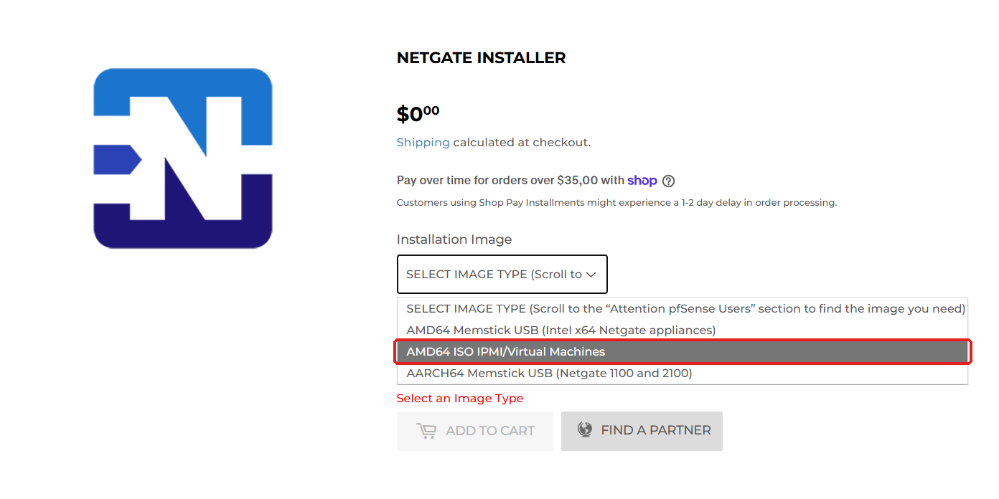
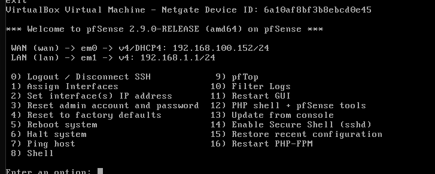
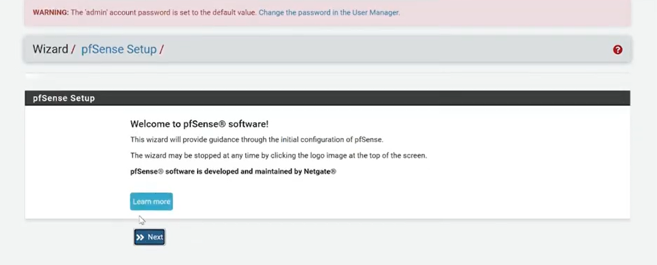
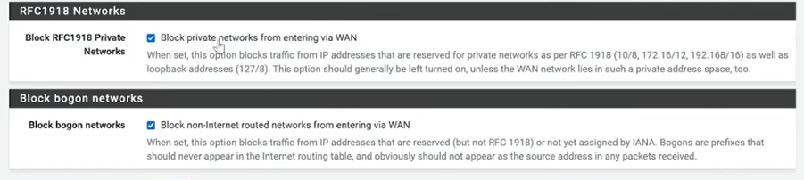
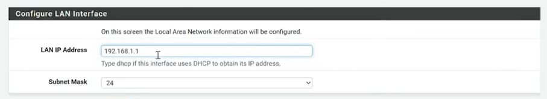
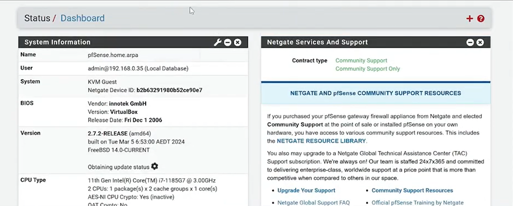

## Descarga del instalador
Para la implementación de la herramienta de firewall pfsense se debe ingresar a la siguiente url;

[Download pfSense Community Edition](https://www.pfsense.org/download/)

Se debe seleccionar la opción que se muestra a continuación.

  

  <em>Figura 1. Descarga de pfSense: selecciona la opción AMD64 ISO IPMI/Virtual Machines para instalarlo en una máquina virtual.</em>

Una vez descargado el instalador, se debe descomprimir el archivo para obtener la ISO, importar la ISO, configurar las 2 interfaces de red en virtualbox (una en modo puente y la otra con conexión hacia una red interna que conectará con la máquina ubuntu), ejecutar la máquina e instalar el firewall pfsense. Una vez hecho todo lo anterior, se debe remover del disco óptico de virtualbox la ISO y reiniciar la máquina. Al hacer eso, aparecerá la terminal que se muestra en la figura 2.

  

  <em>Figura 2. Menú de consola de pfSense con la WAN (em0) en 192.168.100.152/24 por DHCP y la LAN (em1) en 192.168.1.1/24.</em>

## Configuración de interfaces de red e ingreso al gestor del firewall
Como se observa en la figura, se aprecian 2 interfaces de red (que son las que se configuraron anteriormente antes de arrancar la máquina con la iso). En este caso, cada una tiene asignada una dirección ip mediante protocolo DHCP. En el caso de que no se tenga dirección ip en alguna interfaz, se puede solicitar mediante protocolo DHCP con la opción 2. Una vez ambas interfaces tengan dirección IP asignada, se debe deshabilitar el firewall de pfsense para poder acceder al gestor web de este mismo con el comando pfsense -d. Una vez hecho eso, se puede ingresar al gestor con las credenciales por defecto admin-pfsense. una vez dentro, se verá algo así,

  

  <em>Figura 3. Pantalla de bienvenida del asistente de configuración inicial de pfSense (Wizard / pfSense Setup).</em>

Se debe dar a siguiente hasta encontrar las opciones que se muestran en la figura 4,

  

  <em>Figura 4; Opciones de bloqueo en la interfaz WAN.</em>

Se deben desmarcar las 2 opciones para permitir el acceso de la máquina kali hacia el gestor web del firewall. Una vez hecho eso, se puede ingresar sin problemas a la interfaz web del firewall. La red LAN a la que se conectará la máquina ubuntu se dejó con la configuración expuesta en la figura 5,

  

  <em>Figura 5. Configuración de la interfaz LAN de pfSense: dirección IP 192.168.1.1 con máscara de subred /24.</em>

Por último, se debe configurar una nueva contraseña para el inicio de sesión en la interfaz web. Luego de esto, es probable que se tenga que deshabilitar de nuevo el cortafuegos de pfsense con el comando pfclt -d. Una vez finalizado el porceso, se verá una página como la que se muestra en la figura 6.

  

  <em>Figura 6. Dashboard de pfSense (Status / Dashboard) con la información del sistema: versión 2.7.2-RELEASE (amd64) ejecutándose en una máquina virtual de VirtualBox.</em>

Una vez hecho esto, se debe añadir una regla en el firewall en la opción

**Firewall → Rules → WAN**

