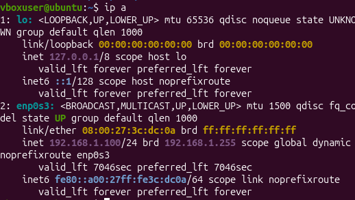
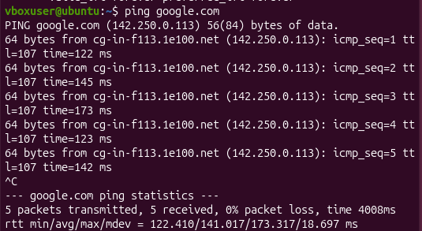
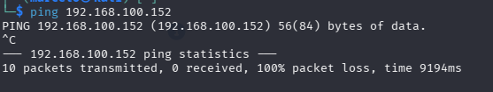
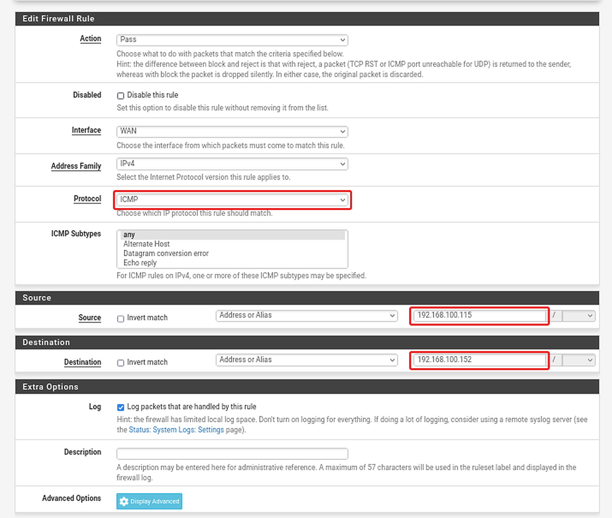
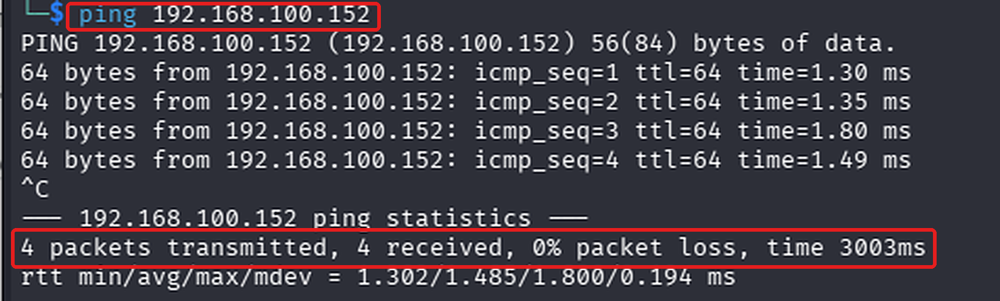
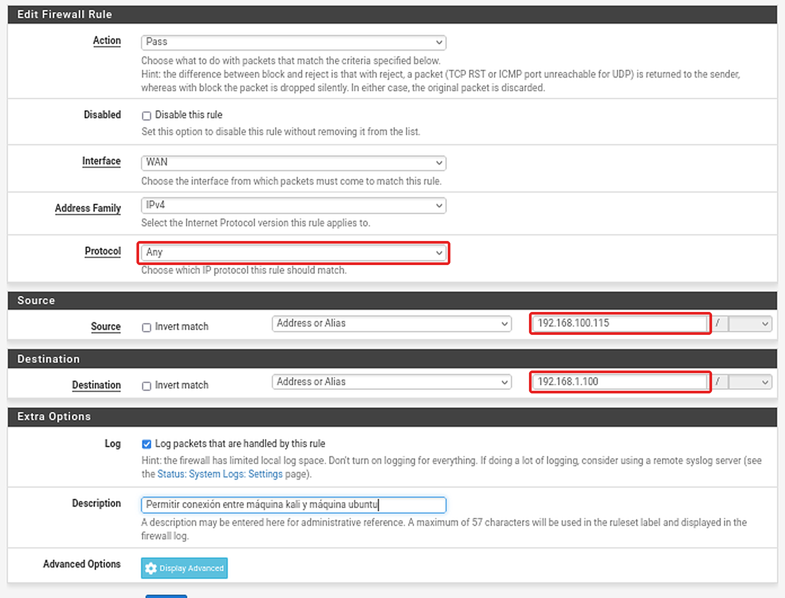

## Configuración de servidor DHCP para la máquina ubuntu
Antes de configurar más reglas en el firewall, es necesario configurar un servidor DHCP que permita que la máquina Ubuntu adquiera una dirección IP dentro de la red interna. Para eso de debe ir a las opciones Services → DHCP server en pfsense, marcar la opción de habilitar servidor DHCP en la interfaz LAN, dejar las configuraciones de IP como están y configurar la IP del servidor DNS como la IP del router doméstico (192.168.100.1 en este caso), lo cual permite resolución DNS. Una vez hecho esto, se debe ingresar a la máquina Ubuntu para confirmar si se le asignó dirección ip con el comando ip a por ejemplo como se ilustra en la figura 1.

  

  <em>Figura 1. Configuración de red de Ubuntu: la interfaz enp0s3 obtiene la IP 192.168.1.100/24 por DHCP desde pfSense.</em>

Como se ve en la figura, la máquina Ubuntu tiene asignada una dirección IP mediante el servidor DHCP que se configuró anteriormente, se puede probar si presenta salida a internet haciendo ping a google.com (además así se verifica también la resolución DNS).

  

  <em>Figura 2. Prueba de conectividad desde Ubuntu: ping a google.com con 0% de pérdida de paquetes, lo que confirma la resolución DNS y la salida a internet a través de pfSense.</em>

Como se aprecia, hay salida a internet y resolución DNS. 

## Configuración de regla de paso de tráfico ICMP a través del firewall
Al intentar hacer conexión al firewall pfsense a través de la máquina kali se aprecia que no llega ningún paquete.

  

  <em>Figura 2. Intento de conexión mediante ping desde Kali hacia la interfaz WAN de pfSense (192.168.100.152): 10 paquetes enviados, 0 recibidos y 100% de pérdida, ya que el firewall bloquea el tráfico ICMP entrante por defecto.</em>

Debido a que no hay reglas en el firewall que permitan el tráfico ICMP hacia este mismo, todos los paquetes enviados con el comando ping son descartados (ya que utilizan el protocolo ICMP). Se creará una regla de paso en el firewall que permita el paso de dicho tráfico. Para ello hay que dirigirse a Firewall → Rules → WAN y pulsar en añadir nueva regla. Una vez en la configuración de regla, se debe agragar en la interfaz WAN la dirección IP de la máquina kali en Source (192.160.100.115), la dirección IP del firewall de la interfaz WAN en destination (192.168.100.152 en este caso) y establecer el protocolo en ICMP. La configuración debería haber quedado de la siguiente manera,

  

  <em>Figura 3. Regla de firewall en la interfaz WAN de pfSense: se permite el tráfico ICMP (Pass) desde Kali (192.168.100.115) hacia la IP de la WAN (192.168.100.152) para habilitar el ping.</em>

Después de guardar la configuración y aplicar los cambios es posible hacer conexión con el firewall mediante el comando ping.

  

  <em>Figura 4. Conexión exitosa mediante ping desde Kali hacia la interfaz WAN de pfSense (192.168.100.152): 4 paquetes enviados, 4 recibidos y 0% de pérdida, tras agregar la regla que permite el tráfico ICMP.</em>

## Permitir el acceso de la máquina kali hacia la red interna LAN
Para permitir que la máquina kali tenga conexión con la máquina ubuntu, se debe crear una nueva regla de paso en el firewall que permita el paso de tráfico desde la IP de kali hacia la máquina ubuntu. La configuración quedaría de la siguiente manera.

  

  <em>Figura 5. Regla de firewall en la interfaz WAN de pfSense: se permite todo el tráfico (Pass, protocolo Any) desde Kali (192.168.100.115) hacia Ubuntu (192.168.1.100) para habilitar la comunicación entre ambas máquinas.</em>

