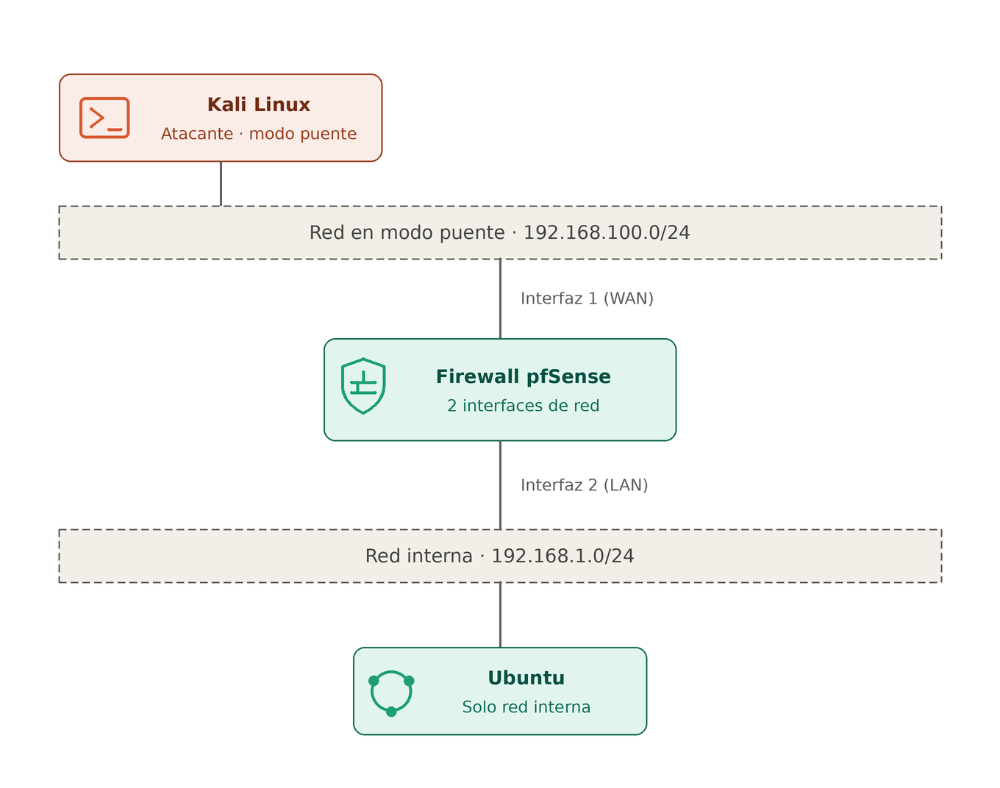

 ## 1. Topología y Segmentación de Red
El laboratorio implementa un perímetro de red virtualizado utilizando pfSense como pasarela de seguridad entre la red externa y el segmento interno protegido.

- **Red WAN:** Conectada al host/Internet mediante DHCP (`em0`).
- **Red LAN (`192.168.1.0/24`):** Segmento interno aislado donde también se conectará la máquina Ubuntu (`em1`).

La figura 1 ilustra un diagrama que permite visualizar de mejor manera la topología de red}

  

  <em>Figura 1. Topología del laboratorio: Kali Linux y la interfaz WAN de pfSense comparten la red en modo puente (192.168.100.0/24); la interfaz LAN de pfSense da a la red interna (192.168.1.0/24), donde está Ubuntu.</em>

## 2. Especificaciones de Hardware Virtual
- **pfSense Firewall:** 
  - vCPU: 1-2
  - RAM: 2 GB
  - Almacenamiento: 20 GB VDI
  - Tipo de conexión: Modo puente y red interna (2 interfaces de red)
- **Ubuntu-Desktop:** 
  - vCPU: 2
  - RAM: 4 GB
  - Almacenamiento: 40 GB VDI
  - Tipo de conexión: Modo red interna
- **Kali-Linux:** 
  - vCPU: 2
  - RAM: 4 GB
  - Almacenamiento: 40 GB VDI
  - Tipo de conexión: Modo puente.

