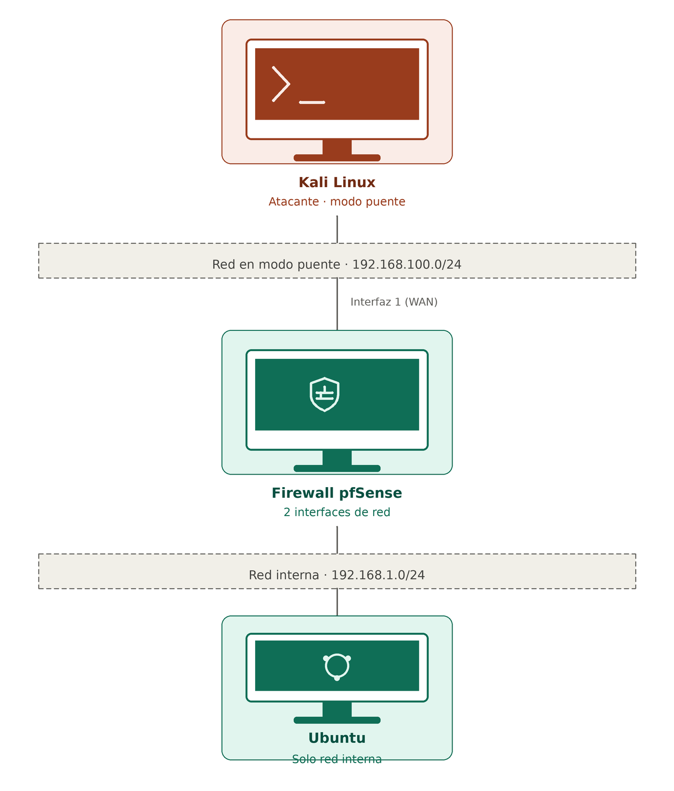

# Firewall-implementation
Proyecto de implementación de firewall y reglas para bloqueo y paso de tráfico de red entre distintas redes mediante herramienta open source pfsense y máquinas virtuales.

  

## 📐 Topología y Segmentación de Red

| Equipo | Interfaz en VirtualBox | Dirección IP / Subred | Función |
| :--- | :--- | :--- | :--- |
| **pfSense (WAN)** | Adaptador Puente | `192.168.100.X/24` | Interfaz externa expuesta a la red puente |
| **pfSense (LAN)** | Red Interna (`intnet`) | `192.168.1.1/24` | Gateway por defecto para segmento interno |
| **Kali Linux** | Adaptador Puente | `192.168.100.Y/24` | Simulación de origen externo / auditoría |
| **Ubuntu** | Red Interna (`intnet`) | `192.168.1.Z/24` | Cliente interno protegido |

---

## 🛡️ Políticas y Reglas de Firewall Configuradas

### Reglas implementadas en la interfaz WAN

1. **Permitir ICMP hacia la WAN de pfSense:**
   * *Acción:* `PASS`
   * *Protocolo:* ICMP
   * *Origen:* `192.168.100.115` (Kali)
   * *Destino:* `192.168.100.152` (IP WAN de pfSense)
   * *Justificación:* Permitir el ping desde Kali hacia la propia interfaz WAN de pfSense, bloqueado por defecto en todo firewall.

2. **Rechazar tráfico TCP desde Kali hacia Ubuntu:**
   * *Acción:* `REJECT`
   * *Protocolo:* TCP
   * *Origen:* `192.168.100.115` (Kali)
   * *Destino:* `192.168.1.100` (Ubuntu)
   * *Justificación:* Bloquear explícitamente las conexiones TCP (SSH, HTTP, etc.) desde el atacante hacia Ubuntu, devolviendo un paquete RST en lugar de descartar en silencio. **Debe ubicarse por encima de la regla 3**, ya que pfSense aplica la primera coincidencia de arriba hacia abajo.

3. **Permitir todo el tráfico desde Kali hacia Ubuntu:**
   * *Acción:* `PASS`
   * *Protocolo:* Any
   * *Origen:* `192.168.100.115` (Kali)
   * *Destino:* `192.168.1.100` (Ubuntu)
   * *Justificación:* Habilitar la comunicación general entre Kali y Ubuntu a través del firewall, necesaria además de la ruta estática agregada en Kali (`sudo ip route add 192.168.1.0/24 via 192.168.100.152`).

### Ajustes relacionados (no son reglas, pero afectan el filtrado)

4. **Desactivar "Block private networks" en la interfaz WAN:**
   * *Ubicación:* Interfaces → WAN
   * *Justificación:* Por defecto pfSense descarta el tráfico entrante en la WAN que provenga de redes privadas (RFC1918). Como la WAN del laboratorio está en `192.168.100.0/24`, una red privada, esta opción debe quedar desmarcada o todo el tráfico de Kali se bloquearía antes de llegar a evaluar las reglas.

---

**Nota sobre el orden:** en pfSense las reglas se evalúan de arriba hacia abajo y se aplica la primera que coincide. Para que el `REJECT` de la regla 2 tenga efecto sobre el tráfico TCP, debe estar antes que la regla 3 (`PASS` / Any) en la lista de **Firewall → Rules → WAN**.

---

## 🧪 Pruebas de Verificación (Testing)

### 1. Verificación de Reglas de Rechazo/Bloqueo desde Kali Linux
* **Prueba:** prueba de conectividad `ping` desde Kali Linux hacia la IP de la máquina Ubuntu e intento de ataque DoS mediante envío de tráfico TCP.

